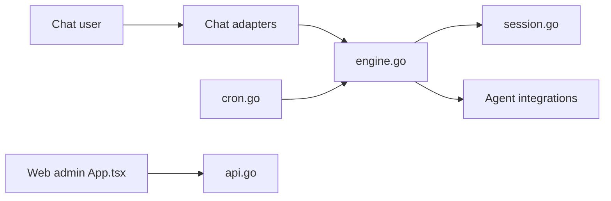

# chenhg5/cc-connect

> Bridge between local coding agents (Claude Code, Codex, Gemini…) and chat platforms such as Telegram or Slack.

## The problem
A local coding agent can only be driven from its terminal, not from a phone or a team messaging app.

## What it actually does
Relays messages from 13 platforms (Feishu, Telegram, Slack, Discord, DingTalk…) to an agent installed locally, with per-project sessions, `/model`, `/mode`, `/dir` commands, scheduled `/cron` tasks, file sending, Unix user isolation (`run_as_user`) and a web interface on port 9820.

## How it is wired


## Trying it
```bash
npm install -g cc-connect
cc-connect
```

## Cost and gotchas
You must install and authenticate the agent first (otherwise `cc-connect` exits). A bot token per platform. No declared license. The `/mode yolo` mode approves all tools automatically.

## What it is not
It is not an agent: it relays to the ones you have installed. The README also offers commercial collaborations.

## Alternatives
Not documented: the README names no alternative.

## For you
Worth watching: handy for driving an agent remotely, but with no license and a risky full-approval mode on your machine.
