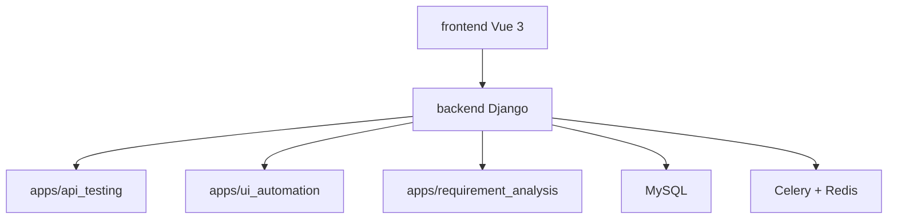

# chenjigang4167/testhub_platform

> AI-assisted test management platform: cases, API, web UI, Android and performance (README in Chinese).

## The problem
Test teams juggle separate tools for test cases, APIs, UI, mobile and load.

## What it actually does
Brings together case management and reviews, API tests (HTTP, WebSocket), UI with Selenium or Playwright, Android with Airtest, load with Locust and a "data factory" of over 50 tools. AI generates cases from requirements documents and drives a browser (browser-use). Django backend, Vue 3 frontend.

## How it is wired
Diagram based on the structure described in the README.


## Trying it
```bash
pip install -r requirements.txt
cp .env.example .env
python manage.py migrate
python manage.py runserver
cd frontend && npm install && npm run dev
```

## Cost and gotchas
Free, but MySQL 8 is required, Redis and Java are optional, and the AI models (DeepSeek, OpenAI...) are billed by their providers. Python 3.12 recommended. The README contains an advertisement for a proxy.

## What it is not
Not a language-model evaluation tool in the MLOps sense, even though it contains an `llm_judge` module. Documentation is in Chinese.

## Alternatives
No alternative named in the README.

## For you
Worth watching: the AI angle for generating tests is interesting, but it is a heavy platform documented in Chinese.
