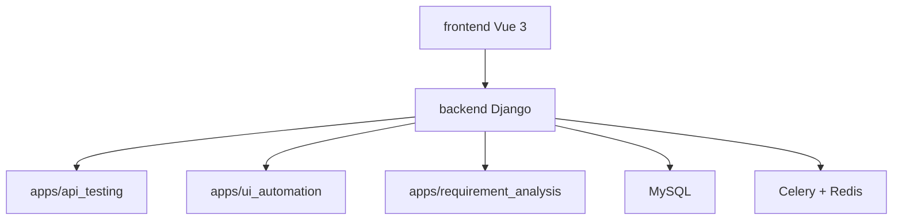

# chenjigang4167/testhub_platform

> Plateforme de gestion de tests assistée par IA : cas, API, UI web, Android et performance (README en chinois).

## Le problème
Les équipes de test jonglent entre outils séparés pour les cas de test, les API, l'UI, le mobile et la charge.

## Ce que ça fait vraiment
Réunit gestion de cas et revues, tests d'API (HTTP, WebSocket), UI avec Selenium ou Playwright, Android avec Airtest, charge avec Locust et une « data factory » de plus de 50 outils. L'IA génère des cas depuis des documents d'exigences et pilote un navigateur (browser-use). Backend Django, frontend Vue 3.

## Comment c'est branché
Schéma d'après la structure décrite dans le README.


## Essayer
```bash
pip install -r requirements.txt
cp .env.example .env
python manage.py migrate
python manage.py runserver
cd frontend && npm install && npm run dev
```

## Coût et pièges
Gratuit, mais MySQL 8 est requis, Redis et Java sont optionnels, et les modèles IA (DeepSeek, OpenAI…) sont facturés par leurs fournisseurs. Python 3.12 recommandé. Le README contient une publicité pour un proxy.

## Ce que ce n'est pas
Pas un outil d'évaluation de modèles de langage au sens MLOps, même s'il contient un module `llm_judge`. Documentation en chinois.

## Alternatives
Aucune alternative nommée dans le README.

## Pour toi
À surveiller : l'angle IA pour générer des tests est intéressant, mais plateforme lourde et documentée en chinois.

