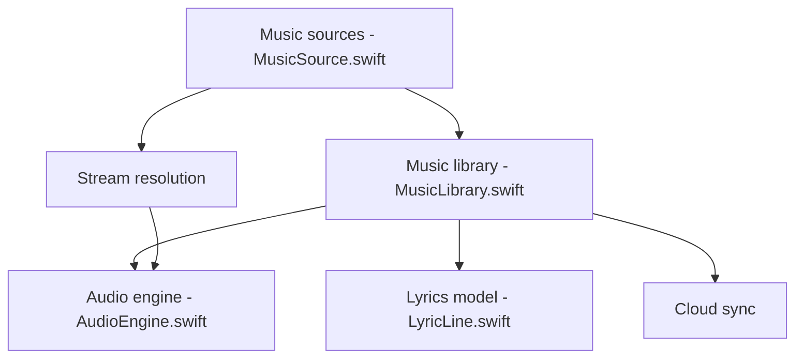

# chenqi92/primuse

> Native Apple music player that brings local files, NAS, servers, clouds and Apple Music into a single library.

## The problem
A music collection scattered across NAS, media servers and clouds forces you to juggle several apps.

## What it actually does
Swift app for iPhone, iPad, Mac, Apple TV and Apple Watch. It connects to SMB, WebDAV, SFTP, Jellyfin, Plex, Navidrome and several clouds, plays many formats (FLAC, DSD, DTS via FFmpeg) and handles CUE, word-by-word lyrics, scrobbling, CloudKit sync and widgets. Metadata scrapers are customizable via JSON and JavaScript.

## How it is wired


## Trying it
```bash
git clone git@github.com:chenqi92/primuse.git
cd primuse
open Primuse.xcodeproj
xcodebuild -project Primuse.xcodeproj -scheme Primuse -destination 'generic/platform=iOS Simulator' build
swift test --package-path PrimuseKit
```

## Cost and gotchas
Xcode 26+ and an Apple Developer account for signing. The app is published on the App Store; Apple Music requires a subscription. OAuth and Last.fm keys go in `Config/Secrets.local.xcconfig`. README written in Chinese.

## What it is not
Provides neither music nor cloud storage. UGOS and fnOS are not supported as NAS sources. The "smart service" is optional.

## Alternatives
No alternative named in the README.

## For you
Ignore: an Apple music player, unrelated to data/AI/MLOps work; only the idea of JSON and JS scrapers might be of interest.
