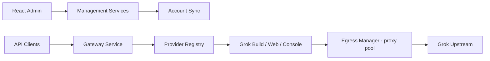

# chenyme/grok2api

> Multi-account Go gateway that exposes Grok Build, Web and Console as an OpenAI/Anthropic API.

## The problem
Grok's three surfaces each have their own authentication, catalog and quotas;
none of them speaks the protocol that clients such as Codex or Claude Code expect.

## What it actually does
Manages three independent account pools, synchronizes their credentials, quotas and models, and
publishes unified routes: Responses, Chat Completions, Anthropic Messages, images, asynchronous
videos, TTS, STT, Realtime. React admin console with dashboard, quota-limited client keys, audits
and billing. Extended network egress layer: HTTP, SOCKS, Trojan, VLESS, Shadowsocks, VMess, proxy
pools, probes, FlareSolverr for Cloudflare.

## How it is wired


## Trying it
```bash
git clone https://github.com/chenyme/grok2api.git
cd grok2api
cp config.example.yaml config.yaml
openssl rand -hex 32
docker compose up -d
docker compose --profile flaresolverr up -d
```

## Cost and gotchas
The README says it upfront: a "technical research and learning" project, and you are responsible
for the consequences with respect to Grok's terms of use. Valid Grok accounts are required; Build
tokens rotate and must not be shared between clients. Never rotate `credentialEncryptionKey` after
data is stored. The account tools may accept the terms and fabricate a date of birth — this is
deliberate circumvention. README truncated.

## What it is not
It is not legitimate access to the xAI API, nor a generic multi-provider gateway. It is not a
supported product: single maintainer, license not declared.

## Alternatives
- **DEEIX-AI / DEEIX-Chat**: cited at the top of the README as an integrated AI platform.

## For you
Avoid in a professional context: the contractual risk far outweighs the technical interest.
