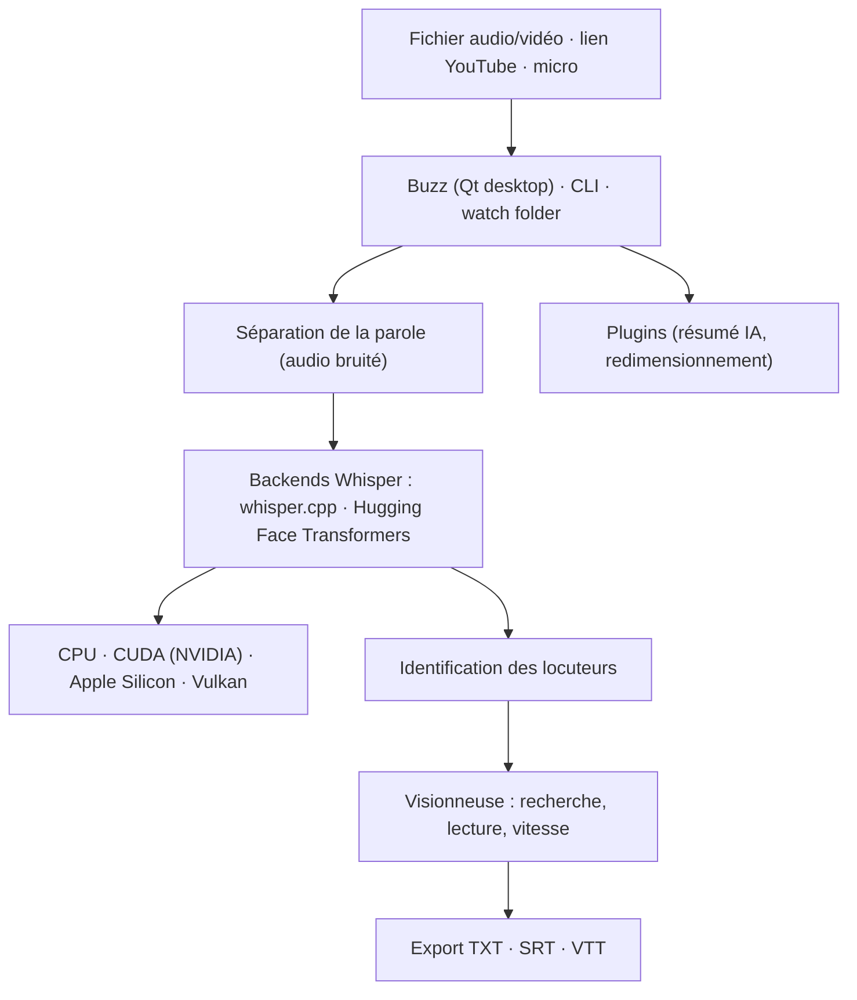

# chidiwilliams/buzz

> Desktop application that transcribes and translates audio offline with Whisper.

## The problem
Transcribing a meeting or a video usually goes through an online service, meaning the file is sent to a third party.
And command-line Whisper offers no interface, no file management and no subtitle export.

## What it actually does
Transcription of audio/video files and YouTube links, plus real-time transcription from the microphone.
Speech separation before transcription on noisy audio, and speaker identification in the transcribed media.
Export to TXT, SRT and VTT, a transcript viewer with search, playback control and speed adjustment.
Folder watching to automatically transcribe new files, a command-line interface for scripting, and a plugin system (AI summary, transcript resizing).

## How it is wired


## Trying it
```bash
# Linux — Flatpak
flatpak install flathub io.github.chidiwilliams.Buzz

# Linux — Snap
sudo apt-get install libportaudio2 libcanberra-gtk-module libcanberra-gtk3-module
sudo snap install buzz

# PyPI (Python 3.12, ffmpeg requis)
pip install buzz-captions
python -m buzz

# GPU NVIDIA sous Windows pour la version PyPI
pip3 install -U torch==2.8.0+cu129 torchaudio==2.8.0+cu129 --index-url https://download.pytorch.org/whl/cu129
```

## Cost and gotchas
Free and offline, no API key: the cost is in CPU/GPU and time on large files.
The macOS and Windows installers are not signed (warning at installation), Intel Macs are frozen at 1.4.5, and the PyPI version requires exactly Python 3.12 plus ffmpeg.

## What it is not
It is not a service: nothing is sent to OpenAI, it is Whisper running on your machine with the limits of the chosen model.
It is not a subtitle editing tool: it exports SRT/VTT, it does not do fine timing adjustment.
Translation is limited to what Whisper can do, not a dedicated translation engine.

## Alternatives
No competing repository is named in the README; whisper.cpp and the Hugging Face Whisper models appear there as backends, not as alternatives.

## For you
The desktop tool to keep for transcribing interviews or videos without exfiltrating the audio; the CLI mode and the watch folder make it scriptable in a pipeline.
