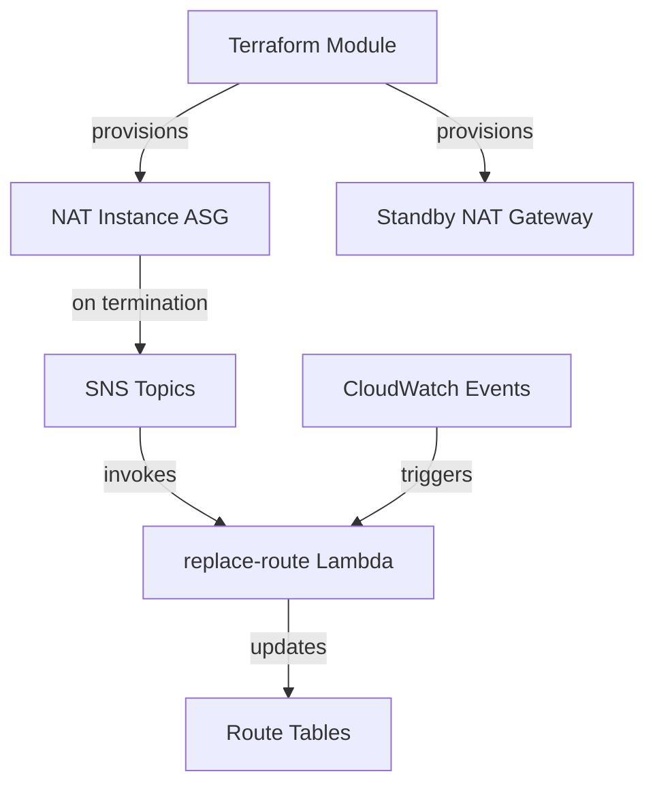

# chime/terraform-aws-alternat

> Terraform module that replaces AWS NAT Gateways with cheaper NAT instances, for cloud teams.

## The problem
NAT Gateways charge $0.045/GB processed. At high traffic (over 10 TB/month), the bill becomes enormous.

## What it actually does
It deploys one NAT instance per zone in an Auto Scaling Group, plus a standby NAT Gateway. A `replace-route` Lambda switches the route table to the Gateway when an instance is terminated or fails the connectivity test (once per minute). Instances are replaced every 14 days by default for patching.

## How it is wired


## Trying it
```bash
docker build . -t <your_registry_url>/<your_repo:<release tag or short git commit sha>
docker push <your_registry_url>/<your_repo:<release tag or short git commit sha>
sam build
sam local invoke <FUNCTION NAME> -e <event_filename>.json
```
The module is then called via `source = "chime/alternat/aws"`.

## Cost and gotchas
AWS account, EC2 instances and outbound traffic at your expense; Lambda image to build and push (no public image). Open TCP connections are cut at each instance replacement.

## What it is not
Not cost-effective below about 10 TB/month: hourly costs dominate. Not suited to long transfers that do not resume after a cut. Not a managed NAT: you operate EC2 instances.

## Alternatives
Managed AWS NAT Gateways: simpler, no cuts, but billed per GB.

## For you
Worth watching: relevant only if your AWS bill shows heavy NAT traffic, otherwise it is infrastructure to maintain for nothing.
