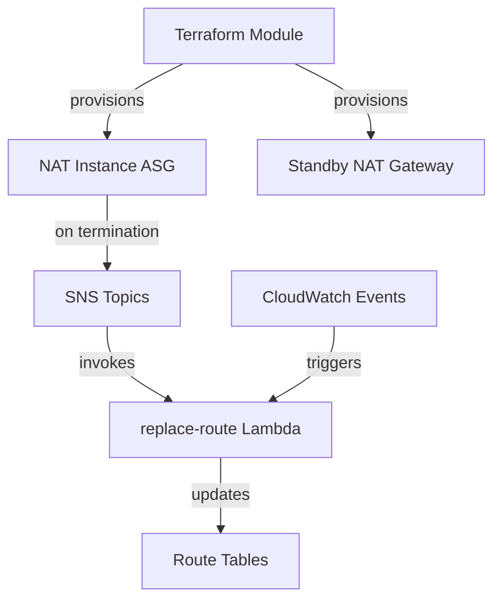

# chime/terraform-aws-alternat

> Module Terraform qui remplace les NAT Gateways AWS par des instances NAT moins chères, pour les équipes cloud.

## Le problème
Les NAT Gateways facturent 0,045 $/Go traité. À fort trafic (plus de 10 To/mois), la facture devient énorme.

## Ce que ça fait vraiment
Il déploie une instance NAT par zone dans un Auto Scaling Group, plus une NAT Gateway de secours. Une Lambda `replace-route` bascule la table de routage vers la Gateway lors d'une terminaison ou d'un échec du test de connectivité (une fois par minute). Les instances sont remplacées tous les 14 jours par défaut pour les patchs.

## Comment c'est branché


## Essayer
```bash
docker build . -t <your_registry_url>/<your_repo:<release tag or short git commit sha>
docker push <your_registry_url>/<your_repo:<release tag or short git commit sha>
sam build
sam local invoke <FUNCTION NAME> -e <event_filename>.json
```
Le module s'appelle ensuite via `source = "chime/alternat/aws"`.

## Coût et pièges
Compte AWS, instances EC2 et trafic sortant à ta charge ; image de Lambda à construire et pousser (pas d'image publique). Les connexions TCP ouvertes sont coupées à chaque remplacement d'instance.

## Ce que ce n'est pas
Pas rentable sous environ 10 To/mois : les coûts horaires dominent. Pas adapté aux transferts longs qui ne reprennent pas après coupure. Pas un NAT géré : tu opères des EC2.

## Alternatives
Les NAT Gateways AWS gérées : plus simples, sans coupure, mais facturées au Go.

## Pour toi
Surveiller : pertinent seulement si ta facture AWS montre un gros trafic NAT, sinon c'est de l'infra à maintenir pour rien.

