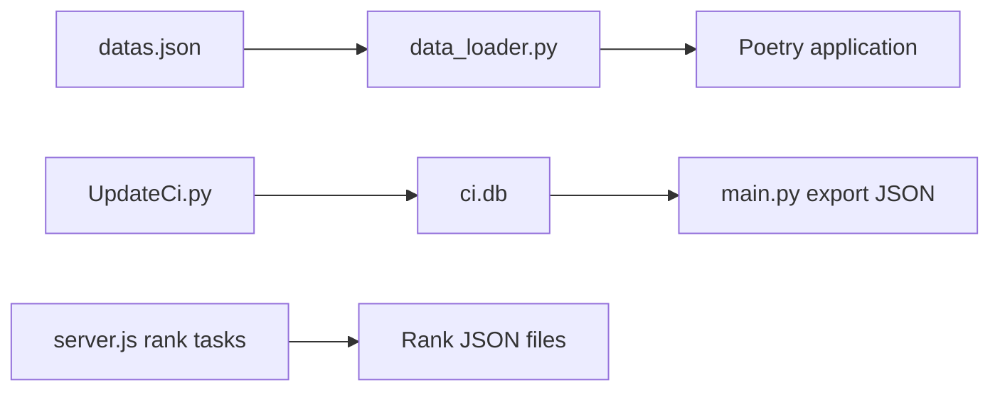

# chinese-poetry/chinese-poetry

> JSON database of classical Chinese poetry (Tang, Song, ci…) for developers of poetry or NLP applications.

## The problem
The great classical anthologies exist in books, not in a form a program can use. A structured, copyable corpus is missing.

## What it actually does
Distributes as JSON about 55,000 Tang poems, 260,000 Song poems, 21,000 Song ci and other collections (Shijing, Lunyu, Huajianji…). A `data_loader.py` loads a collection described in `datas.json`. Separate scripts update the ci from a remote source (`UpdateCi.py`), export from SQLite (`ci.db`, `main.py`) and compute search rankings (`server.js`). The internal formats were not inspected.

## How it is wired


## Trying it
```bash
# Aucune commande documentée dans ce README.
# Les données sont des fichiers JSON à copier ou à charger via data_loader.py.
```

## Cost and gotchas
Free. The README states that the collection was not logged (target sites limiting access, interruptions); corrections must cite a source.

## What it is not
It is not an application or a model: data only. Its editorial quality (variants, errors) rests on contributions, with no guarantee.

## Alternatives
- PaddlePaddle/PaddleNLP: poem generation from this corpus, cited in the README.
- justdark/pytorch-poetry-gen: char-RNN generation, cited in the README.

## For you
Watch: useful as a corpus for a classical Chinese NLP project, but it relies on a single person and on an undocumented collection.
