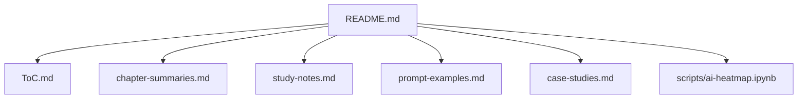

# chiphuyen/aie-book

> Companion resources for Chip Huyen's book "AI Engineering": summaries, notes, case studies.

## The problem
Building applications on foundation models raises questions about evaluation, RAG, agents and fine-tuning with no common framework.

## What it actually does
The repository contains Markdown files: table of contents, chapter summaries, study notes, resources, prompt examples, case studies, an appendix, and a notebook with a heatmap of ChatGPT and Claude conversations. The book itself is sold at O'Reilly and elsewhere; it is not in the repository. It contains almost no code.

## How it is wired

Diagram taken from the repository: the diagram provided wrongly assumes a build chain.

## Trying it
No command: read the Markdown files on GitHub. The notebook `scripts/ai-heatmap.ipynb` opens in Jupyter.

## Cost and gotchas
The repository's resources are free; the book is paid. No license is declared: reuse of the content is not explicitly allowed.

## What it is not
Not a code tutorial: the README says so. Not the complete book. The diagram provided (Pandoc build, CI) is imagined and matches nothing in the repository.

## Alternatives
- Designing Machine Learning Systems: the author's previous book, cited as a complement.

## For you
Adopt as background reading: covers evaluation, RAG, agents and optimization, with principles that age more slowly than tools.
