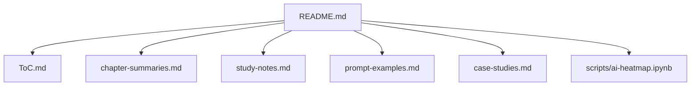

# chiphuyen/aie-book

> Ressources complémentaires du livre « AI Engineering » de Chip Huyen : résumés, notes, cas d'étude.

## Le problème
Construire des applications sur modèles de fondation soulève des questions d'évaluation, de RAG, d'agents et d'ajustement sans cadre commun.

## Ce que ça fait vraiment
Le dépôt contient des fichiers Markdown : table des matières, résumés de chapitres, notes d'étude, ressources, exemples de prompts, cas d'étude, annexe, et un notebook de heatmap de conversations ChatGPT et Claude. Le livre lui-même est vendu chez O'Reilly et ailleurs ; il n'est pas dans le dépôt. Il ne contient presque pas de code.

## Comment c'est branché

Schéma tiré du dépôt : le diagramme fourni suppose à tort une chaîne de build.

## Essayer
Aucune commande : lire les fichiers Markdown sur GitHub. Le notebook `scripts/ai-heatmap.ipynb` s'ouvre dans Jupyter.

## Coût et pièges
Les ressources du dépôt sont gratuites ; le livre est payant. Aucune licence n'est déclarée : la réutilisation du contenu n'est pas autorisée explicitement.

## Ce que ce n'est pas
Pas un tutoriel de code : le README le dit. Pas le livre complet. Le diagramme fourni (build Pandoc, CI) est imaginé et ne correspond à rien dans le dépôt.

## Alternatives
- Designing Machine Learning Systems : livre précédent de l'autrice, cité comme complément.

## Pour toi
À adopter comme lecture de fond : couvre évaluation, RAG, agents et optimisation, avec des principes qui vieillissent moins vite que les outils.

