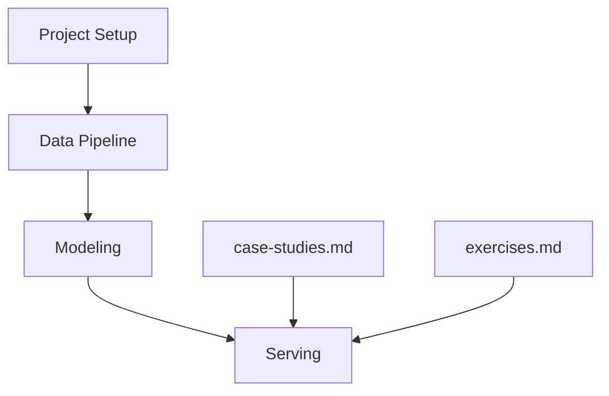

# chiphuyen/machine-learning-systems-design

> A 2019 booklet on machine learning systems design, with 27 interview questions.

## The problem
Knowing how to frame an end-to-end ML system, from data preparation to keeping it running in production.

## What it actually does
A text in four stages: project setup, data pipeline, modeling, serving (testing, deployment, maintenance). It points to resources and company case studies, and ends with 27 open-ended questions.

## How it is wired


## Trying it
```bash
npm install magicbook
git clone https://github.com/chiphuyen/machine-learning-systems-design.git
cd machine-learning-systems-design
magicbook build
```

## Cost and gotchas
Free, read online. No license declared: reuse of the text is not guaranteed. Last push in April 2023.

## What it is not
Not an executable system. The author states that her book Designing Machine Learning Systems (O'Reilly, 2022) is more complete and up to date.

## Alternatives
The book Designing Machine Learning Systems by the same author (cited in the README).

## For you
Worth watching as ML framing reading, but prefer the 2022 book that the author herself recommends.
