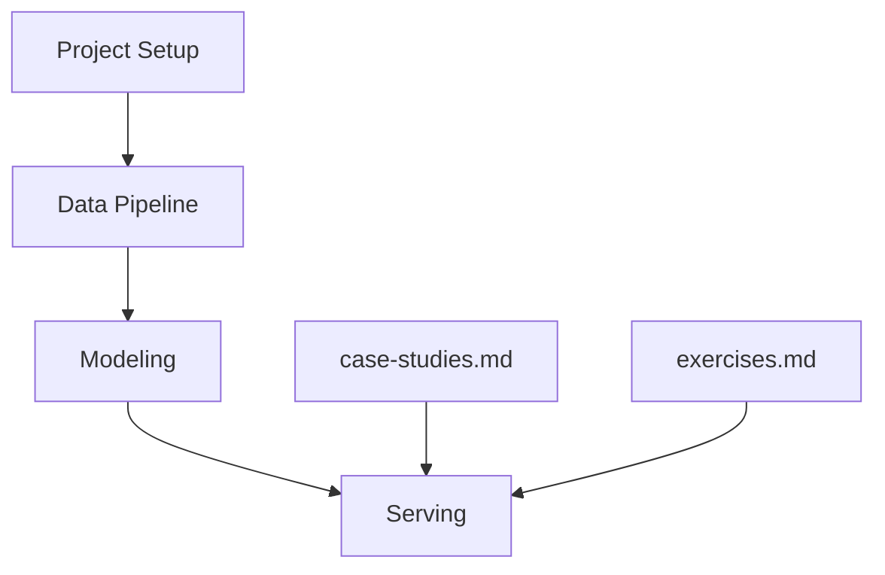

# chiphuyen/machine-learning-systems-design

> Opuscule de 2019 sur la conception de systèmes de machine learning, avec 27 questions d'entretien.

## Le problème
Savoir comment cadrer un système ML de bout en bout, de la préparation des données au maintien en production.

## Ce que ça fait vraiment
Texte en quatre étapes : cadrage du projet, pipeline de données, modélisation, service (tests, déploiement, maintenance). Il renvoie vers des ressources et des études de cas d'entreprises, et se termine par 27 questions ouvertes.

## Comment c'est branché


## Essayer
```bash
npm install magicbook
git clone https://github.com/chiphuyen/machine-learning-systems-design.git
cd machine-learning-systems-design
magicbook build
```

## Coût et pièges
Gratuit, lecture en ligne. Aucune licence déclarée : réutilisation du texte non garantie. Dernier push en avril 2023.

## Ce que ce n'est pas
Pas un système exécutable. L'auteure indique que son livre Designing Machine Learning Systems (O'Reilly, 2022) est plus complet et à jour.

## Alternatives
Le livre Designing Machine Learning Systems de la même auteure (cité dans le README).

## Pour toi
À surveiller comme lecture de cadrage ML, mais préfère le livre de 2022 que l'auteure recommande elle-même.

