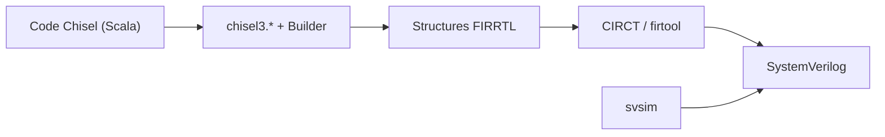

# chipsalliance/chisel

> Hardware description language embedded in Scala, generating synthesizable Verilog for ASIC and FPGA.

## The problem
Writing parameterizable, reusable digital circuits, which classic hardware languages do poorly.

## What it actually does
Adds hardware construction primitives to Scala. Chisel code runs as a circuit generator and produces (System)Verilog via FIRRTL and the CIRCT/firtool tool. The README shows an LED blinker and an FIR filter parameterized by its coefficients. Tests go through `svsim` (Verilator, VCS) and the older `chiseltest`.

## How it is wired


## Trying it
```bash
git clone https://github.com/chipsalliance/chisel.git
cd chisel
./mill chisel[].compile
./mill chisel[].test
```

## Cost and gotchas
Free. Tests require verilator, yosys, espresso, slang and filecheck in the `PATH`. Project maintained under CHIPS Alliance, more than 500 open issues.

## What it is not
Not a standalone simulation tool nor a software tool: it generates Verilog, synthesis remains to be done elsewhere.

## Alternatives
None cited in the README.

## For you
Ignore: circuit design, useful if you build AI accelerators on FPGA, but outside the scope of a data/MLOps profile.
