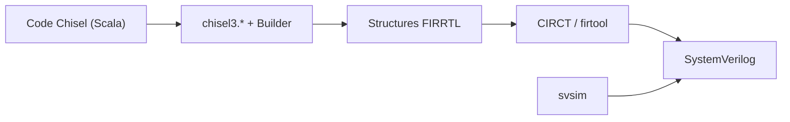

# chipsalliance/chisel

> Langage de description matérielle embarqué dans Scala, qui génère du Verilog synthétisable pour ASIC et FPGA.

## Le problème
Écrire des circuits numériques paramétrables et réutilisables, ce que les langages matériels classiques font mal.

## Ce que ça fait vraiment
Ajoute à Scala des primitives de construction matérielle. Le code Chisel s'exécute comme un générateur de circuit et produit du (System)Verilog via FIRRTL et l'outil CIRCT/firtool. Le README montre un clignotant de LED et un filtre FIR paramétré par ses coefficients. Les tests passent par `svsim` (Verilator, VCS) et d'anciens `chiseltest`.

## Comment c'est branché


## Essayer
```bash
git clone https://github.com/chipsalliance/chisel.git
cd chisel
./mill chisel[].compile
./mill chisel[].test
```

## Coût et pièges
Gratuit. Les tests demandent verilator, yosys, espresso, slang et filecheck dans le `PATH`. Projet maintenu sous CHIPS Alliance, plus de 500 issues ouvertes.

## Ce que ce n'est pas
Pas un outil de simulation seul ni de logiciel : il génère du Verilog, la synthèse reste à faire ailleurs.

## Alternatives
Aucune citée dans le README.

## Pour toi
Ignorer : conception de circuits, utile si tu fais des accélérateurs IA sur FPGA, mais hors périmètre d'un profil data/MLOps.

