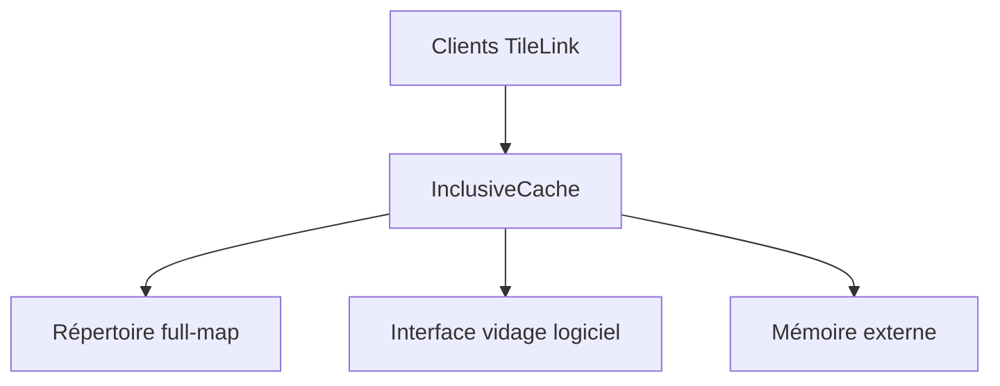

# chipsalliance/rocket-chip-inclusive-cache

> RTL generator for a coherent inclusive last-level cache for Rocket Chip SoCs, for chip designers.

## The problem
A multicore SoC needs a shared cache that maintains coherence between its clients.

## What it actually does
The `InclusiveCache` controller enforces invalidation-based coherence on the TileLink 1.8.1 protocol, with a full-map directory stored in the tags of each block. It replaces Rocket-Chip's `tilelink.BroadcastHub` and offers a software flush interface by physical address. Configurable: size, ways, banking, external bandwidth, network buffers.

## How it is wired


## Trying it
```bash
# Aucune commande documentée dans le README
```

## Cost and gotchas
Free, but requires the Rocket Chip ecosystem (Chisel, not detailed in the README). Unit tests announced as "coming soon".

## What it is not
Not a software cache: it is hardware (RTL). The README says nothing about installation.

## Alternatives
`sifive/block-inclusivecache-sifive`: the repository this one replaces.

## For you
Ignore: chip design, outside the data / AI / MLOps scope.
