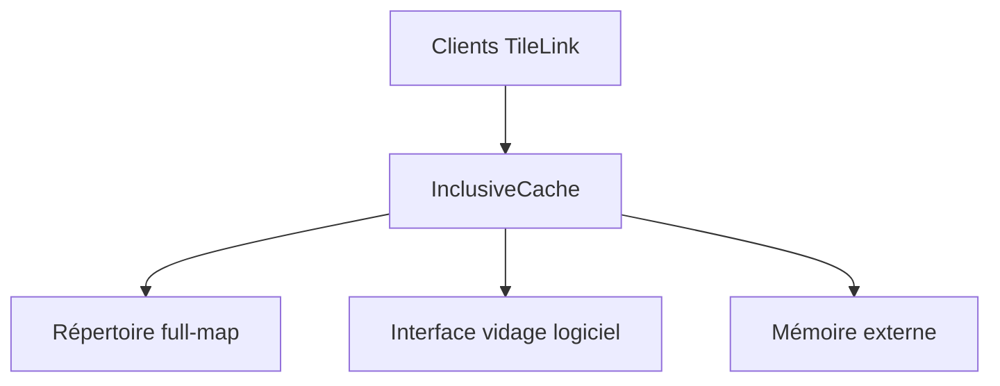

# chipsalliance/rocket-chip-inclusive-cache

> Générateur RTL de cache inclusif de dernier niveau cohérent pour SoC Rocket Chip, pour concepteurs de puces.

## Le problème
Un SoC multicœur a besoin d'un cache partagé qui maintient la cohérence entre ses clients.

## Ce que ça fait vraiment
Le contrôleur `InclusiveCache` impose la cohérence par invalidation sur le protocole TileLink 1.8.1, avec un répertoire en full-map stocké dans les tags de chaque bloc. Il remplace `tilelink.BroadcastHub` de Rocket-Chip et offre une interface logicielle de vidage par adresse physique. Paramétrable : taille, voies, banking, bande passante externe, tampons réseau.

## Comment c'est branché


## Essayer
```bash
# Aucune commande documentée dans le README
```

## Coût et pièges
Gratuit, mais exige l'écosystème Rocket Chip (Chisel, non détaillé dans le README). Tests unitaires annoncés « coming soon ».

## Ce que ce n'est pas
Pas un cache logiciel : c'est du matériel (RTL). Le README ne dit rien d'installation.

## Alternatives
`sifive/block-inclusivecache-sifive` : dépôt que celui-ci remplace.

## Pour toi
Ignorer : conception de puces, hors du périmètre data / IA / MLOps.

