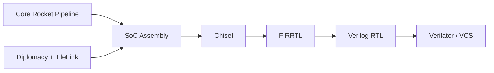

# chipsalliance/rocket-chip

> Chisel generator of RISC-V systems-on-chip around the Rocket core, for hardware designers.

## The problem
Designing a parameterizable RISC-V SoC by hand requires rewriting buses, caches and peripherals for each configuration.

## What it actually does
Scala program that calls the Chisel compiler and emits Verilog describing a complete SoC: in-order Rocket core, caches, TileLink and AMBA buses negotiated by "diplomacy", debug, JTAG, peripherals. Submodules chisel3, firrtl, hardfloat, rocket-tools, torture. Simulation with Verilator or VCS.

## How it is wired


## Trying it
```bash
git clone https://github.com/ucb-bar/rocket-chip.git
cd rocket-chip
git submodule update --init
make verilog
make verilog CONFIG=freechips.rocketchip.system.DefaultSmallConfig
```

## Cost and gotchas
Free. Dependencies to install from the sub-projects (rocket-tools, chisel3). License "present but not identified" by GitHub. The README mentions `ucb-bar/rocket-chip` whereas the repo is under chipsalliance.

## What it is not
Not a ready-to-use core: a generator to configure. Not tied to AI, even though accelerators can be plugged in.

## Alternatives
No alternative named in the README.

## For you
Ignore: hardware design, outside the data/AI/MLOps profile, unless you have a custom accelerator project.
