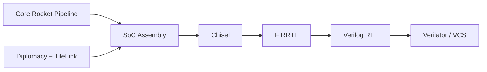

# chipsalliance/rocket-chip

> Générateur Chisel de systèmes sur puce RISC-V autour du cœur Rocket, pour concepteurs de matériel.

## Le problème
Concevoir un SoC RISC-V paramétrable à la main demande de réécrire bus, caches et périphériques pour chaque configuration.

## Ce que ça fait vraiment
Programme Scala qui appelle le compilateur Chisel et émet du Verilog décrivant un SoC complet : cœur Rocket en ordre, caches, bus TileLink et AMBA négociés par « diplomacy », débogage, JTAG, périphériques. Sous-modules chisel3, firrtl, hardfloat, rocket-tools, torture. Simulation Verilator ou VCS.

## Comment c'est branché


## Essayer
```bash
git clone https://github.com/ucb-bar/rocket-chip.git
cd rocket-chip
git submodule update --init
make verilog
make verilog CONFIG=freechips.rocketchip.system.DefaultSmallConfig
```

## Coût et pièges
Gratuit. Dépendances à installer depuis les sous-projets (rocket-tools, chisel3). Licence « présente mais non identifiée » par GitHub. Le README mentionne `ucb-bar/rocket-chip` alors que le dépôt est sous chipsalliance.

## Ce que ce n'est pas
Pas un cœur prêt à utiliser : un générateur à configurer. Pas lié à l'IA, même si des accélérateurs peuvent s'y brancher.

## Alternatives
Aucune alternative nommée dans le README.

## Pour toi
Ignorer : conception matérielle, hors profil data/IA/MLOps, sauf projet d'accélérateur sur mesure.

