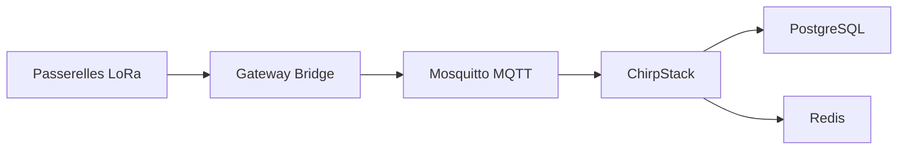

# chirpstack/chirpstack-docker

> Docker Compose example to set up a ChirpStack v4 LoRaWAN network server, for IoT projects.

## The problem
Installing ChirpStack by hand requires connecting the server, an MQTT broker, PostgreSQL, Redis and gateways.

## What it actually does
A docker-compose.yml launches ChirpStack, two Gateway Bridge instances (Semtech UDP on port 1700, Basics Station on port 3001), Mosquitto, PostgreSQL and Redis. All regions are preconfigured, with EU868 by default. The web interface is on port 8080, the REST API on 8090.

## How it is wired


## Trying it
```bash
docker compose up
# puis http://localhost:8080/

make import-device-profiles
```

## Cost and gotchas
Docker required, plus `make` to import device profiles. The README warns that this file is a test starting point, to be adapted for production. You also need to change the regional MQTT prefix in the compose file.

## What it is not
Not ChirpStack itself: it is its deployment skeleton. Not production-ready as is.

## Alternatives
No alternative named in the README.

## For you
Ignore unless you have a LoRaWAN IoT project: nothing here concerns data or AI, it is a deployment skeleton for a sensor network.
