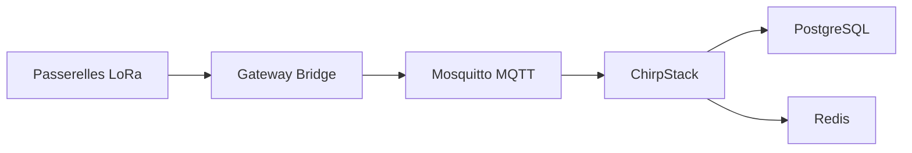

# chirpstack/chirpstack-docker

> Exemple Docker Compose pour monter un serveur réseau LoRaWAN ChirpStack v4, pour les projets IoT.

## Le problème
Installer ChirpStack à la main demande de relier le serveur, un broker MQTT, PostgreSQL, Redis et des passerelles.

## Ce que ça fait vraiment
Un docker-compose.yml lance ChirpStack, deux instances de Gateway Bridge (UDP Semtech sur le port 1700, Basics Station sur le port 3001), Mosquitto, PostgreSQL et Redis. Toutes les régions sont préconfigurées, avec EU868 par défaut. L'interface web est sur le port 8080, l'API REST sur 8090.

## Comment c'est branché


## Essayer
```bash
docker compose up
# puis http://localhost:8080/

make import-device-profiles
```

## Coût et pièges
Docker requis, plus `make` pour importer les profils d'appareils. Le README prévient que ce fichier est un point de départ de test, à adapter pour la production. Il faut aussi changer le préfixe MQTT de région dans le compose.

## Ce que ce n'est pas
Pas ChirpStack lui-même : c'est son squelette de déploiement. Pas prêt pour la production tel quel.

## Alternatives
Aucune alternative nommée dans le README.

## Pour toi
À ignorer sauf projet IoT LoRaWAN : rien ici ne concerne la data ou l'IA, c'est un squelette de déploiement pour réseau de capteurs.

