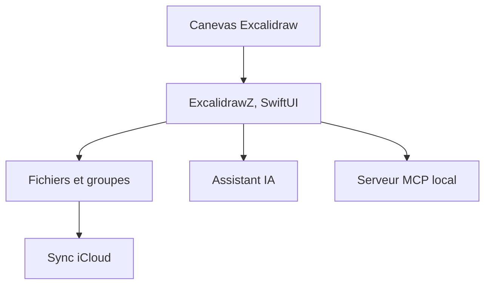

# chocoford/ExcalidrawZ

> Native Excalidraw client for macOS, iPadOS and iOS, with iCloud sync, history and an AI assistant.

## The problem
Excalidraw in a browser handles files, history and stylus input poorly on Apple devices.

## What it actually does
A SwiftUI app that keeps the Excalidraw canvas and adds file management, iCloud sync, history checkpoints, export (PDF, PNG and editable SVG) and collaboration. It includes an AI assistant that reads and edits drawings, with a preview of proposals, and an MCP server. Locked and encrypted files are hidden from the AI.

## How it is wired
Simplified diagram based on the sheet, no diagram provided.

## Trying it
No command: download the `.dmg` from Releases and drag it into Applications.

## Cost and gotchas
The `.dmg` is free; building it requires an `Overrides.xcconfig` with your development team and an iCloud container. The README does not say which models or keys power the AI assistant.

## What it is not
It is not web Excalidraw nor a cross-platform application: it only runs on the Apple ecosystem.

## Alternatives
No alternative named in the README.

## For you
Ignore: an Apple drawing tool; only the MCP server could be useful for architecture diagrams, but the value remains thin.
