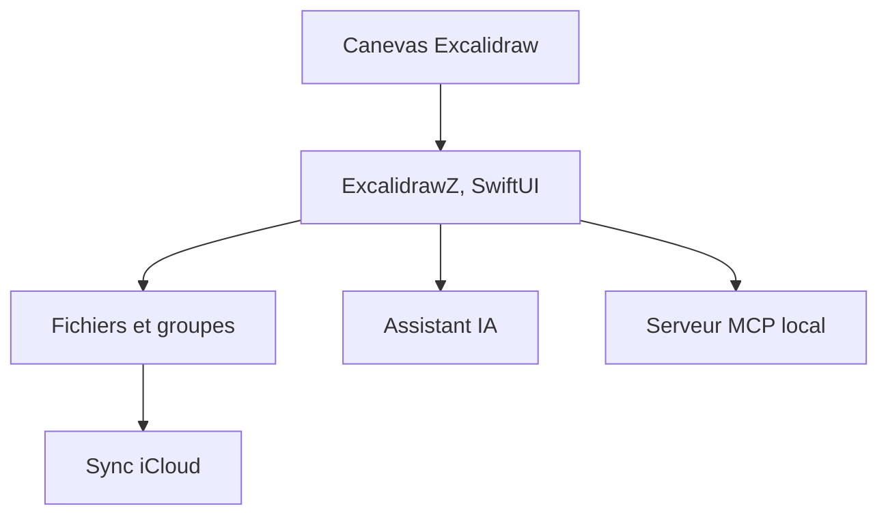

# chocoford/ExcalidrawZ

> Client Excalidraw natif pour macOS, iPadOS et iOS, avec synchronisation iCloud, historique et assistant IA.

## Le problème
Excalidraw dans un navigateur gère mal les fichiers, l'historique et le stylet sur les appareils Apple.

## Ce que ça fait vraiment
Application SwiftUI qui garde le canevas Excalidraw et ajoute une gestion de fichiers, une synchronisation iCloud, des points de contrôle d'historique, l'export (PDF, PNG et SVG éditables) et la collaboration. Elle intègre un assistant IA qui lit et modifie les dessins, avec aperçu des propositions, et un serveur MCP. Fichiers verrouillés et chiffrés, cachés de l'IA.

## Comment c'est branché
Schéma simplifié d'après la fiche, sans diagramme fourni.

## Essayer
Aucune commande : télécharger le `.dmg` depuis Releases et le glisser dans Applications.

## Coût et pièges
Gratuit pour le `.dmg` ; la compilation demande un `Overrides.xcconfig` avec ton équipe de développement et un conteneur iCloud. Le README ne précise pas quels modèles ou clés alimentent l'assistant IA.

## Ce que ce n'est pas
Ce n'est pas Excalidraw web ni une application multiplateforme : elle ne tourne que sur l'écosystème Apple.

## Alternatives
Aucune alternative nommée dans le README.

## Pour toi
À ignorer : outil de dessin Apple ; seul le serveur MCP peut servir à des schémas d'architecture, mais l'intérêt reste mince.

