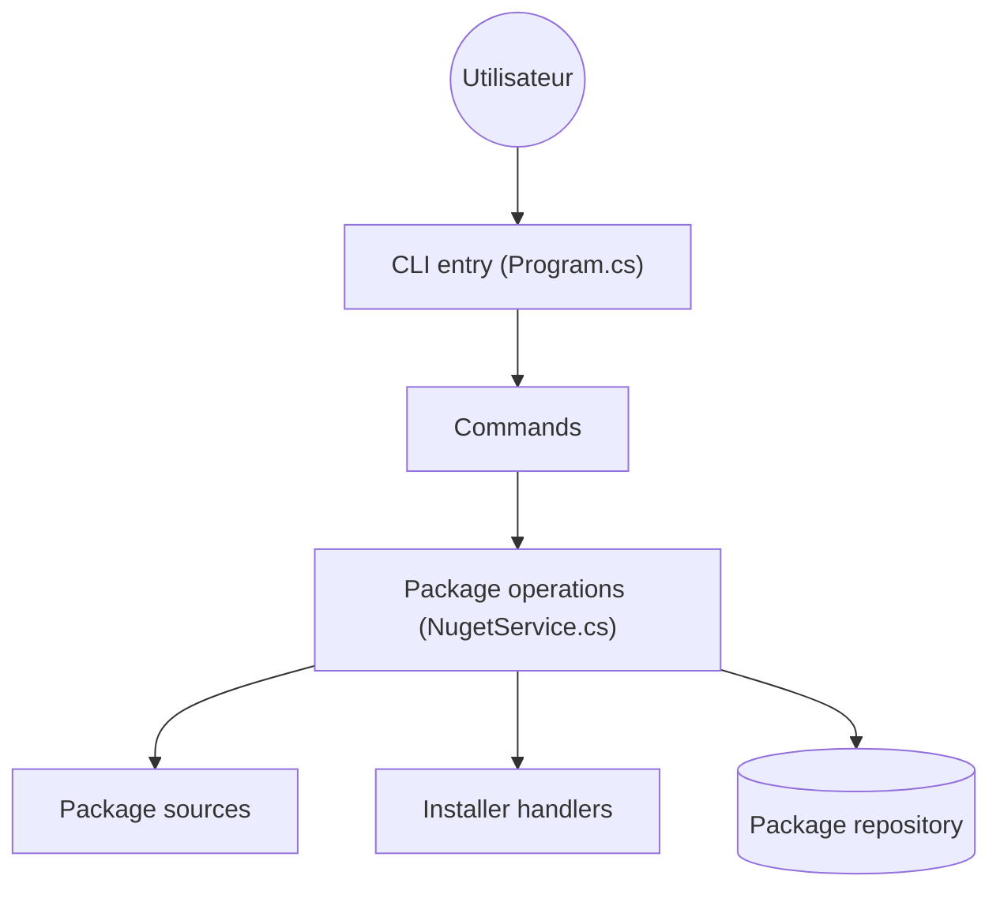

# chocolatey/choco

> Command-line package manager for Windows, in the style of apt-get or yum.

## The problem
Installing and updating Windows software by hand, with no single command or reproducible script.

## What it actually does
The `choco` command resolves package sources (NuGet format), installs, updates or removes, then `refreshenv` reloads environment variables. Free edition; commercial editions exist with their own support.

## How it is wired


## Trying it
```bash
choco.exe --help
choco.exe install --help
./build.sh   # compilation hors Windows, via Mono
```

## Cost and gotchas
Free in the open edition. Requires .NET Framework 4.8+ and PowerShell 2.0+. Windows only; building with Mono is described as rough.

## What it is not
Not a Linux/macOS tool (unofficial ports). Packages in the community repository are maintained by volunteers.

## Alternatives
- winget: cited in the EarTrumpet README as another Windows package client.

## For you
Ignore if you work on Linux or in containerized MLOps; useful only for equipping a Windows workstation.
