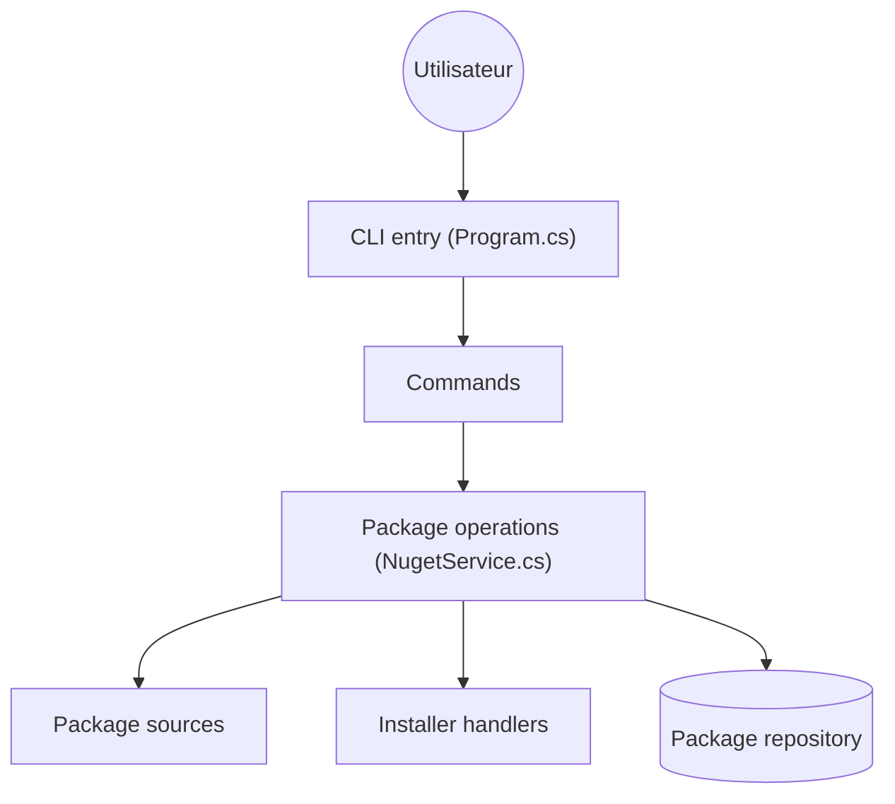

# chocolatey/choco

> Gestionnaire de paquets en ligne de commande pour Windows, façon apt-get ou yum.

## Le problème
Installer et mettre à jour des logiciels Windows à la main, sans commande unique ni script reproductible.

## Ce que ça fait vraiment
La commande `choco` résout des sources de paquets (format NuGet), installe, met à jour ou supprime, puis `refreshenv` recharge les variables d'environnement. Édition libre ; des éditions commerciales existent avec leur propre support.

## Comment c'est branché


## Essayer
```bash
choco.exe --help
choco.exe install --help
./build.sh   # compilation hors Windows, via Mono
```

## Coût et pièges
Gratuit en édition libre. Exige .NET Framework 4.8+ et PowerShell 2.0+. Windows uniquement ; la compilation Mono est décrite comme rugueuse.

## Ce que ce n'est pas
Pas un outil Linux/macOS (ports non officiels). Les paquets du dépôt communautaire sont maintenus par des bénévoles.

## Alternatives
- winget : cité dans le README d'EarTrumpet comme autre client de paquets Windows.

## Pour toi
Ignorer si tu travailles sous Linux ou en MLOps conteneurisé ; utile seulement pour outiller un poste Windows.

