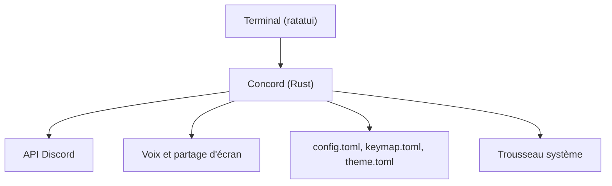

# chojs23/concord

> Terminal Discord client, written in Rust with ratatui, with voice and screen sharing.

## The problem
Discord forces you to run a heavy client, even though you already live in your terminal.

## What it actually does
Vim-keybinding interface for servers, channels, threads and forums. It handles search, reactions, replies, image previews, GIFs via KLIPY, DeepL or LibreTranslate translation, a notification inbox and rich presence. Voice offers push-to-talk, noise suppression and screen broadcasting. Themes and keys are set through TOML files.

## How it is wired
Simplified diagram based on the sheet, no diagram provided.



## Trying it
```bash
cargo install concord --locked
brew install concord
npm install -g @chojs23/concord
```

## Cost and gotchas
Free. A Discord token is needed; logging in by e-mail or QR code may trigger a CAPTCHA. Using a third-party client with a user account may violate Discord's rules, hence the security safeguards. Building requires Rust, CMake and libclang. License to be verified.

## What it is not
Not an official client. Shortcuts may change between versions.

## Alternatives
- No alternative named in the README.

## For you
Ignore: messaging client unrelated to your work, with an account risk to weigh.
