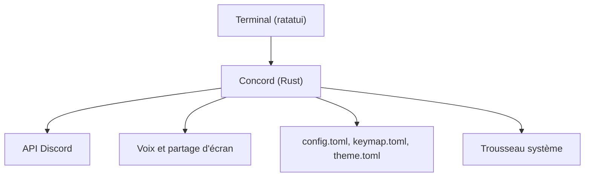

# chojs23/concord

> Client Discord en terminal, écrit en Rust avec ratatui, avec voix et partage d'écran.

## Le problème
Discord oblige à lancer un client lourd, alors qu'on vit déjà dans son terminal.

## Ce que ça fait vraiment
Interface à raccourcis vim pour serveurs, salons, fils et forums. Elle gère recherche, réactions, réponses, aperçus d'images, GIF via KLIPY, traduction DeepL ou LibreTranslate, boîte de notifications et présence enrichie. La voix propose appui pour parler, suppression de bruit et diffusion d'écran. Thèmes et touches se règlent par fichiers TOML.

## Comment c'est branché
Schéma simplifié d'après la fiche, sans diagramme fourni.



## Essayer
```bash
cargo install concord --locked
brew install concord
npm install -g @chojs23/concord
```

## Coût et pièges
Gratuit. Il faut un jeton Discord ; la connexion par e-mail ou QR peut déclencher un CAPTCHA. L'usage d'un client tiers avec un compte utilisateur peut contrevenir aux règles de Discord, d'où des garde-fous de sécurité. La compilation exige Rust, CMake et libclang. Licence à vérifier.

## Ce que ce n'est pas
Pas un client officiel. Les raccourcis peuvent changer entre versions.

## Alternatives
- Aucune alternative nommée dans le README.

## Pour toi
À ignorer : client de messagerie sans rapport avec le métier, avec un risque de compte à peser.

