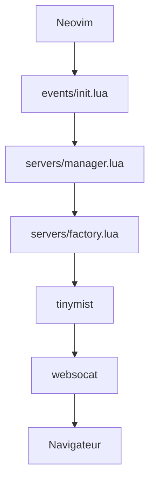

# chomosuke/typst-preview.nvim

> Neovim plugin for live preview of Typst documents, with cross-jumping between code and preview.

## The problem
Writing Typst in Neovim without an instant preview forces you to recompile a PDF.

## What it actually does
Starts a tinymist preview server and shows the incremental rendering in the browser. Clicking on the preview takes you back to the line of code; the preview follows the cursor. According to the code, `servers/manager.lua` launches tinymist via `factory.lua`, `fetch.lua` downloads the binaries and `websocat` relays to the browser.

## How it is wired


## Trying it
```lua
{ 'chomosuke/typst-preview.nvim', lazy = false, version = '1.*', opts = {} }
```
```vim
:TypstPreview
:TypstPreviewStop
```

## Cost and gotchas
Free. Downloads tinymist and websocat into Neovim's data folder; `curl` required. GPL-3.0 license. The server cannot listen on 0.0.0.0.

## What it is not
Not a Typst compiler: it relies on tinymist.

## Alternatives
niuiic/typst-preview.nvim (higher latency, no cross-jump) and Enter-tainer/typst-preview.

## For you
Worth watching if you write your reports in Typst under Neovim: good preview, but of no interest otherwise.
