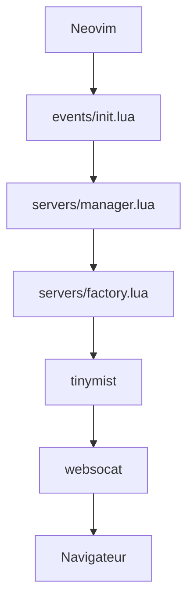

# chomosuke/typst-preview.nvim

> Plugin Neovim d'aperçu en direct des documents Typst, avec saut croisé entre code et aperçu.

## Le problème
Rédiger en Typst sous Neovim sans aperçu instantané oblige à recompiler un PDF.

## Ce que ça fait vraiment
Démarre un serveur d'aperçu tinymist et affiche le rendu incrémental dans le navigateur. Un clic sur l'aperçu renvoie à la ligne de code ; l'aperçu suit le curseur. D'après le code, `servers/manager.lua` lance tinymist via `factory.lua`, `fetch.lua` télécharge les binaires et `websocat` relaie vers le navigateur.

## Comment c'est branché


## Essayer
```lua
{ 'chomosuke/typst-preview.nvim', lazy = false, version = '1.*', opts = {} }
```
```vim
:TypstPreview
:TypstPreviewStop
```

## Coût et pièges
Gratuit. Télécharge tinymist et websocat dans le dossier de données de Neovim ; `curl` requis. Licence GPL-3.0. Le serveur ne peut pas écouter sur 0.0.0.0.

## Ce que ce n'est pas
Pas un compilateur Typst : il s'appuie sur tinymist.

## Alternatives
niuiic/typst-preview.nvim (latence plus haute, pas de saut croisé) et Enter-tainer/typst-preview.

## Pour toi
À surveiller si tu rédiges tes rapports en Typst sous Neovim : bon aperçu, mais sans intérêt autrement.

