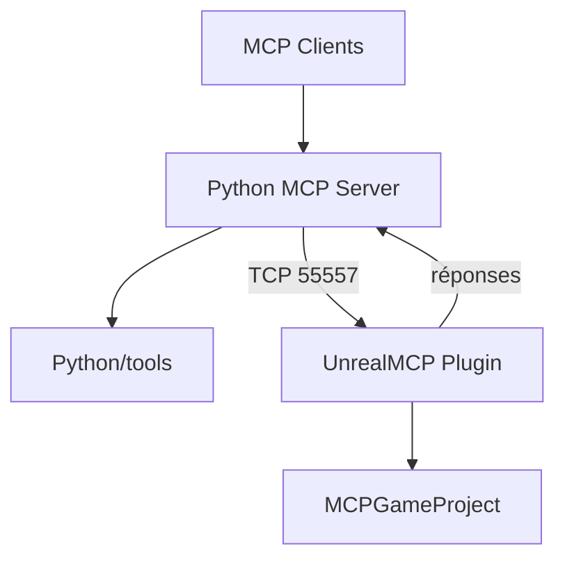

# chongdashu/unreal-mcp

> An MCP server that lets Claude Desktop, Cursor or Windsurf drive Unreal Engine in natural language.

## The problem
Automating the Unreal editor (actors, Blueprints, camera) requires clicking or writing code by hand.

## What it actually does
A C++ plugin opens a TCP server (port 55557) in the editor. A Python FastMCP server translates the AI client's commands into messages to this plugin. It covers actors, Blueprints, graph nodes and the viewport camera.

## How it is wired
Diagram based on the one provided.



## Trying it
```bash
# Python/README.md décrit l'installation ; config client :
uv --directory <path/to/the/folder/PYTHON> run unreal_mcp_server.py
```

## Cost and gotchas
Unreal Engine 5.5+, Python 3.12+ and a Visual Studio build of the plugin. The repository has no license and its last push dates from April 2025.

## What it is not
Not a stable product: the README itself announces an experimental state, possible breaking changes and advises against production use. No license: reuse is legally unclear.

## Alternatives
No alternative named in the README.

## For you
Worth watching only: outside your data/MLOps scope, with no license and no recent activity.
