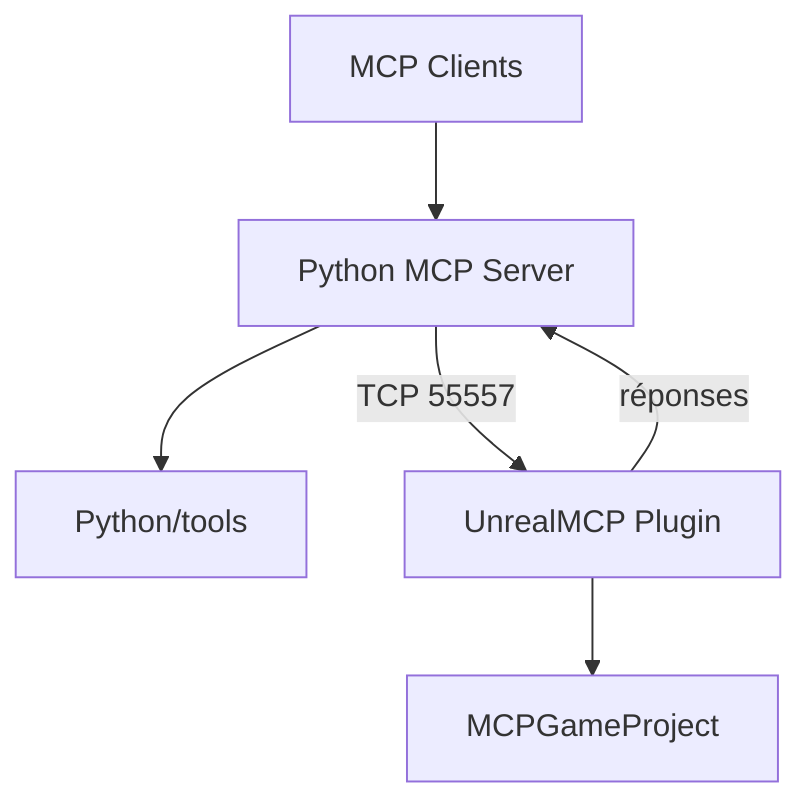

# chongdashu/unreal-mcp

> Un serveur MCP qui laisse Claude Desktop, Cursor ou Windsurf piloter Unreal Engine en langage naturel.

## Le problème
Automatiser l'éditeur Unreal (acteurs, Blueprints, caméra) demande de cliquer ou d'écrire du code à la main.

## Ce que ça fait vraiment
Un plugin C++ ouvre un serveur TCP (port 55557) dans l'éditeur. Un serveur Python FastMCP traduit les commandes du client IA en messages vers ce plugin. Il couvre les acteurs, les Blueprints, les nœuds de graphe et la caméra du viewport.

## Comment c'est branché
Schéma d'après le diagramme fourni.



## Essayer
```bash
# Python/README.md décrit l'installation ; config client :
uv --directory <path/to/the/folder/PYTHON> run unreal_mcp_server.py
```

## Coût et pièges
Unreal Engine 5.5+, Python 3.12+ et un build Visual Studio du plugin. Le dépôt n'a pas de licence et son dernier push date d'avril 2025.

## Ce que ce n'est pas
Pas un produit stable : le README annonce lui-même un état expérimental, des ruptures possibles et déconseille la production. Pas de licence : réutilisation juridiquement floue.

## Alternatives
Aucune alternative nommée dans le README.

## Pour toi
À surveiller seulement : hors de ton périmètre data/MLOps, sans licence et sans activité récente.

