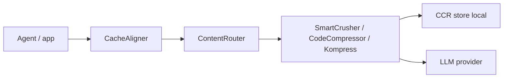

# chopratejas/headroom

> A local proxy that compresses outputs from tools, logs, and history before sending them to the LLM, in order to reduce the number of tokens.

## The problem
Code agents send repetitive tool outputs, which increase token costs.

## What it actually does
A content router selects a compressor (JSON, AST code, text). The originals remain in a local cache, and the model retrieves them via `headroom_retrieve`. It can be used in a library, proxy, agent wrapper, or MCP. Shared memory between agents, `headroom learn`.

## How it is wired


## Trying it
```bash
uv tool install --python 3.13 "headroom-ai[all]"
headroom wrap claude
headroom proxy --port 8787
headroom doctor
headroom dashboard
```

## Cost and gotchas
Free (under Apache 2.0, as stated in the README). Savings of 21 to 57% were observed in the measured scenarios, with very minimal savings in the prose. An anonymous tag is active by default (`HEADROOM_BEACON=off` to disable it).

## What it is not
Not a compression with no effect: the gains depend on the repetitiveness of the data. The catalogue license is not declared.

## Alternatives
The README compares with Compresr, Token Co., and OpenAI Compaction, which are hosted and non-reversible solutions.

## For you
To be used as a test: measure "headroom savings" on your actual traffic before generalizing, and disable telemetry if necessary.
