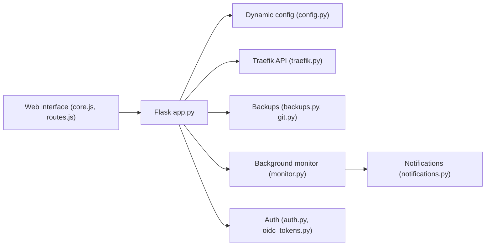

# chr0nzz/traefik-manager

> Self-hosted web interface to drive a Traefik reverse proxy without editing YAML, for homelabbers.

## The problem
Configuring Traefik routes, middlewares and certificates by hand in YAML files is tedious and error-prone.

## What it actually does
Flask application (Python 3.11) that reads and writes Traefik's dynamic configuration files, queries the Traefik API and displays routes, services, middlewares, `acme.json` certificates, CrowdSec and logs. It backs up before each change (git option), monitors routes in the background and sends notifications (Discord, Slack, ntfy, etc.). An optional Go agent manages remote Traefik servers.

## How it is wired


## Trying it
```bash
curl -fsSL https://get-traefik.xyzlab.dev | bash
tm status
tm doctor
```
Or with Docker Compose: image `ghcr.io/chr0nzz/traefik-manager:latest`, port 5000, then open `http://your-server:5000` (setup wizard).

## Cost and gotchas
Free. You already need a Traefik instance. The install script is a `curl | bash`. Changes to `acme.json` require a read-write mount and a restart mode.

## What it is not
It is not a proxy: it is a Traefik configuration editor. Services it did not write stay read-only until you "take them over". Off-topic for a data/AI pipeline.

## Alternatives
No alternative named in the README.

## For you
Worth watching only if you host your ML services behind Traefik: otherwise it is a homelab tool unrelated to data/AI/MLOps, and keep the GPL-3.0 license in mind if you redistribute.
