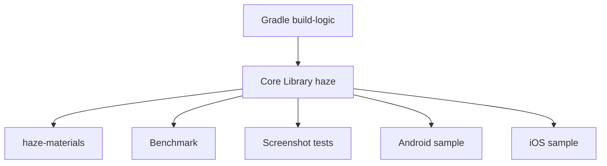

# chrisbanes/haze

> Blur and glass visual effects for Compose Multiplatform, for mobile and desktop app developers.

## The problem
Achieving background blur and glass effects across several Compose platforms requires platform-specific code.

## What it actually does
Kotlin modules: a source-capture core, `haze-blur`, `haze-glass` (refraction, tint, light) and Material 3 styles. Works on Android, iOS, macOS, desktop JVM and Wasm/JS. Can process a camera preview under certain conditions.

## How it is wired


## Trying it
```kotlin
implementation("dev.chrisbanes.haze:haze:<version>")
implementation("dev.chrisbanes.haze:haze-blur:<version>")
```

## Cost and gotchas
Free. Keep all Haze artifacts on the same version. Measure performance on a build close to production.

## What it is not
Not an image-processing or AI library: a Compose interface effect.

## Alternatives
No alternative named in the README.

## For you
Ignore: concerns Compose interface development, not a data / AI / MLOps profile.
