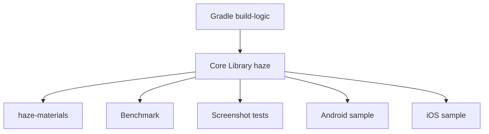

# chrisbanes/haze

> Effets visuels flou et verre pour Compose Multiplatform, pour développeurs d'applications mobiles et bureau.

## Le problème
Réaliser flou d'arrière-plan et effets de verre sur plusieurs plateformes Compose demande du code spécifique à chacune.

## Ce que ça fait vraiment
Modules Kotlin : un cœur de capture de source, `haze-blur`, `haze-glass` (réfraction, teinte, lumière) et des styles Material 3. Fonctionne sur Android, iOS, macOS, JVM bureau et Wasm/JS. Peut traiter un aperçu caméra sous conditions.

## Comment c'est branché


## Essayer
```kotlin
implementation("dev.chrisbanes.haze:haze:<version>")
implementation("dev.chrisbanes.haze:haze-blur:<version>")
```

## Coût et pièges
Gratuit. Garder tous les artefacts Haze à la même version. Mesurer les performances sur un build proche de la production.

## Ce que ce n'est pas
Pas une bibliothèque de traitement d'image ni d'IA : un effet d'interface Compose.

## Alternatives
Aucune alternative nommée dans le README.

## Pour toi
Ignorer : concerne le développement d'interfaces Compose, pas un profil data / IA / MLOps.

