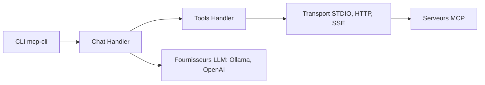

# chrishayuk/mcp-cli

> Command-line client for talking to MCP servers and to local or cloud LLMs.

## The problem
Testing MCP servers and chaining tools with an LLM takes a lot of glue code.

## What it actually does
Chat, interactive, command (scriptable) modes and direct commands. By default Ollama with `gpt-oss`, no key; OpenAI, Anthropic, Azure, Gemini and Groq are possible. Server management, tokens in the keychain or Vault, DAG execution plans, attachments, browser dashboard, HTML MCP apps, experimental virtual memory.

## How it is wired


## Trying it
```bash
ollama pull gpt-oss
uvx mcp-cli --help
mcp-cli --server sqlite
mcp-cli cmd --server sqlite --tool list_tables --output tables.json
```

## Cost and gotchas
Free locally (Ollama, model to download). Cloud providers require an API key at your expense. Some servers (Notion, Monday) go through OAuth.

## What it is not
It is not an MCP server. The README is very long and stacks experimental features (virtual memory, planning): test them one by one.

## Alternatives
No alternative named in the README.

## For you
Watch: a good test bench for MCP servers locally without a key, but a single maintainer and no declared license.
