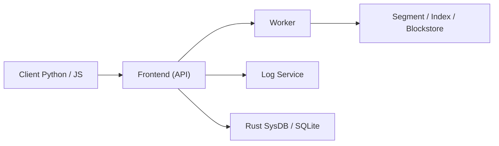

# chroma-core/chroma

> Open-source vector database for AI applications, in embedded, client-server or cloud mode.

## The problem
Storing embeddings and doing similarity search requires dedicated infrastructure and glue code.

## What it actually does
The API fits in a few functions: create a collection, add documents with metadata, query by text, filter. Chroma can compute the embeddings (pluggable functions: OpenAI, Ollama, Cohere, Hugging Face, local ONNX…) or receive yours. The engine is in Rust (HNSW, SPANN, sparse and full-text search), with a distributed mode (worker, log, sysdb) and SQLite locally.

## How it is wired


## Trying it
```bash
pip install chromadb # python client
# for javascript, npm install chromadb!
# for client-server mode, chroma run --path /chroma_db_path
```

## Cost and gotchas
Free locally. Chroma Cloud is paid ($5 of credits offered). 965 open issues; the README says the project is evolving quickly.

## What it is not
Not an embedding model nor a complete RAG framework. The distributed mode requires Kubernetes and object storage.

## Alternatives
No alternative named in the README.

## For you
To adopt for prototyping RAG: two-line start, Apache-2.0 license, and a path to client-server or cloud.
