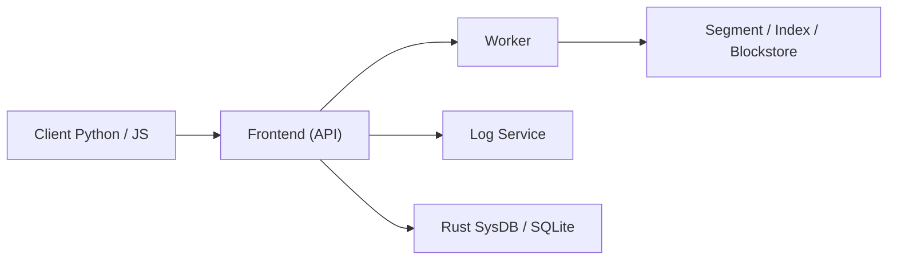

# chroma-core/chroma

> Base de données vectorielle open source pour applications d'IA, en mode embarqué, client-serveur ou cloud.

## Le problème
Stocker des embeddings et faire de la recherche par similarité demande une infrastructure dédiée et du code de glue.

## Ce que ça fait vraiment
L'API tient en quelques fonctions : créer une collection, y ajouter des documents avec métadonnées, interroger par texte, filtrer. Chroma peut calculer les embeddings (fonctions pluggables : OpenAI, Ollama, Cohere, Hugging Face, ONNX local…) ou recevoir les tiens. Le moteur est en Rust (HNSW, SPANN, recherche creuse et plein texte), avec un mode distribué (worker, log, sysdb) et SQLite en local.

## Comment c'est branché


## Essayer
```bash
pip install chromadb # python client
# for javascript, npm install chromadb!
# for client-server mode, chroma run --path /chroma_db_path
```

## Coût et pièges
Gratuit en local. Chroma Cloud est payant (5 $ de crédits offerts). 965 issues ouvertes ; le README dit que le projet évolue vite.

## Ce que ce n'est pas
Pas un modèle d'embedding ni un framework RAG complet. Le mode distribué demande Kubernetes et stockage objet.

## Alternatives
Aucune alternative nommée dans le README.

## Pour toi
À adopter pour prototyper du RAG : démarrage en deux lignes, licence Apache-2.0, et chemin vers client-serveur ou cloud.

