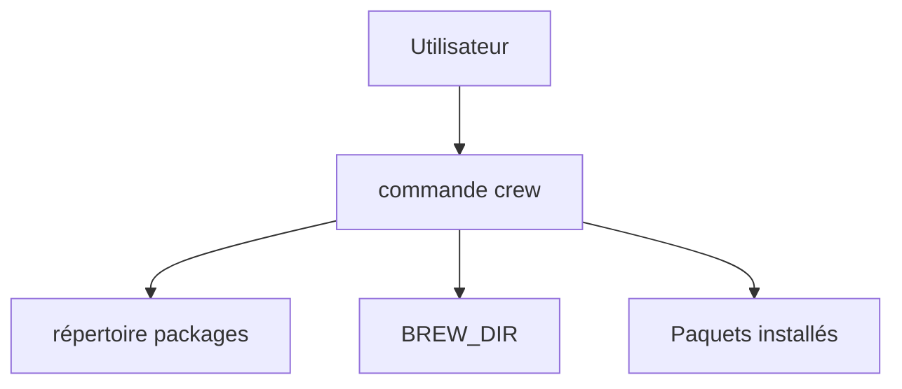

# chromebrew/chromebrew

> Command-line package manager to install Linux software on a Chromebook.

## The problem
ChromeOS runs on a Linux kernel but provides neither a compiler nor a package manager.

## What it actually does
The crew command installs, updates, removes, searches and builds packages from source, with their dependencies. It can also list installed files, check upstream versions and upload binaries. The packages directory contains the recipes.

## How it is wired
Simplified diagram based on the fiche, no diagram provided.


## Trying it
```bash
bash <(curl -L git.io/vddgY) && . ~/.bashrc
crew install --keep [...]
```

## Cost and gotchas
Free, but the Chromebook must be in developer mode (less secure). The beta, dev and Canary channels are not supported. On ChromeOS M117 and later, the installer no longer works in crosh: use a VT-2 terminal. GPL-3.0 license.

## What it is not
Not a complete Linux distribution: a manager grafted onto ChromeOS.

## Alternatives
No alternative named in the README.

## For you
Ignore: only useful if you tinker on a Chromebook; your AI workstation will be a real Linux or a cloud machine.
