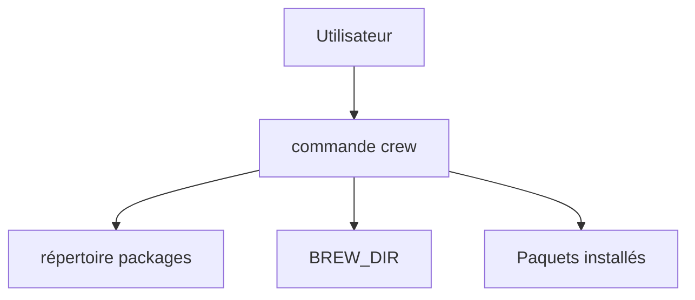

# chromebrew/chromebrew

> Gestionnaire de paquets en ligne de commande pour installer des logiciels Linux sur un Chromebook.

## Le problème
ChromeOS tourne sur un noyau Linux mais ne fournit ni compilateur ni gestionnaire de paquets.

## Ce que ça fait vraiment
La commande crew installe, met à jour, supprime, cherche et construit des paquets depuis les sources, avec leurs dépendances. Elle sait aussi lister les fichiers installés, vérifier les versions amont et téléverser des binaires. Le répertoire packages contient les recettes.

## Comment c'est branché
Schéma simplifié d'après la fiche, sans diagramme fourni.


## Essayer
```bash
bash <(curl -L git.io/vddgY) && . ~/.bashrc
crew install --keep [...]
```

## Coût et pièges
Gratuit, mais le Chromebook doit être en mode développeur (moins sûr). Les canaux beta, dev et Canary ne sont pas pris en charge. Sur ChromeOS M117 et plus, l'installeur ne marche plus dans crosh : passer par un terminal VT-2. Licence GPL-3.0.

## Ce que ce n'est pas
Pas une distribution Linux complète : un gestionnaire greffé sur ChromeOS.

## Alternatives
Aucune alternative nommée dans le README.

## Pour toi
À ignorer : utile seulement si tu bricoles sur Chromebook ; ton poste d'IA sera un vrai Linux ou une machine cloud.

