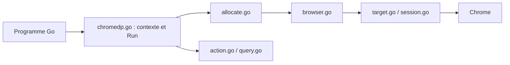

# chromedp/chromedp

> Go library to drive a Chrome browser through the DevTools protocol, with no external dependency.

## The problem
Automating a browser (screenshots, scraping, tests) often requires Selenium or an intermediate server.

## What it is not — field error corrected
(see below)

## What it actually does
Creates a browser context, runs actions in it (navigation, element queries, typing, JavaScript, screenshots, PDF, device emulation) and observes page events. An allocator launches Chrome (headless by default) or connects to an existing instance via websocket.

## How it is wired


## Trying it
```bash
go get -u github.com/chromedp/chromedp
```
The README points to the Go reference and to the examples repository for code.

## Cost and gotchas
Free, but Chrome must be installed; in a headless environment, the `chromedp/headless-shell` image is recommended. On Linux, Chrome is killed at the end of the program.

## What it is not
Not a turnkey tool: it is a Go library, not a CLI. "context canceled" errors signal loss of the connection to the browser.

## Alternatives
- No alternative named in the README.

## For you
Worth watching only if you do scraping or page capture in Go; otherwise a Python data/AI profile has no use for it.
