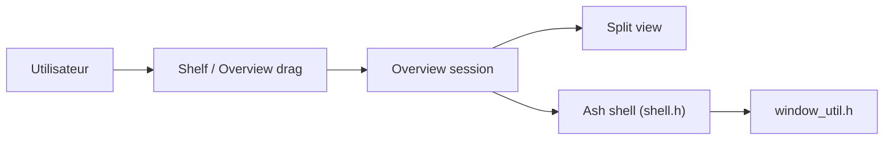

# chromium/chromium

> Source code of the open-source Chromium browser, for contributors and integrators.

## The problem
Very short README: it describes no specific problem beyond the goal of a safer, faster and more stable browser.

## What it actually does
The README points to chromium.org and the `docs/README.md` documentation, and forbids a direct `git clone` (you must follow the fetch instructions). The sampled architecture mostly shows Ash window management (shelf, overview, split view), along with Android WebView; the overall wiring is not documented.

## How it is wired

## Trying it
No command documented in the README; it points to the "get the code" page.

## Cost and gotchas
Fetching and building are out of the ordinary (external instructions); not documented here.

## What it is not
Not a binary to download from this repository. Not enough material to judge further.

## Alternatives
No alternative named in the README.

## For you
Ignore: you use a browser, you do not build one; the README offers nothing actionable for a data/AI profile.
