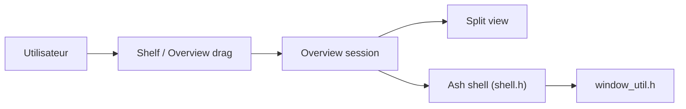

# chromium/chromium

> Code source du navigateur open source Chromium, pour contributeurs et intégrateurs.

## Le problème
README très court : il ne décrit pas de problème précis au-delà de l'objectif d'un navigateur plus sûr, plus rapide et plus stable.

## Ce que ça fait vraiment
Le README renvoie vers chromium.org et la documentation `docs/README.md`, et interdit `git clone` direct (il faut suivre les instructions de récupération). L'architecture échantillonnée montre surtout la gestion de fenêtres Ash (shelf, overview, split view), avec aussi Android WebView ; le câblage global n'est pas documenté.

## Comment c'est branché

## Essayer
Aucune commande documentée dans le README ; il renvoie à la page « get the code ».

## Coût et pièges
Récupération et compilation hors norme (instructions externes) ; non documenté ici.

## Ce que ce n'est pas
Pas un binaire à télécharger depuis ce dépôt. Matière insuffisante pour juger plus loin.

## Alternatives
Aucune alternative nommée dans le README.

## Pour toi
À ignorer : tu utilises un navigateur, tu ne le construis pas ; le README n'offre rien d'actionnable pour un profil data/IA.

