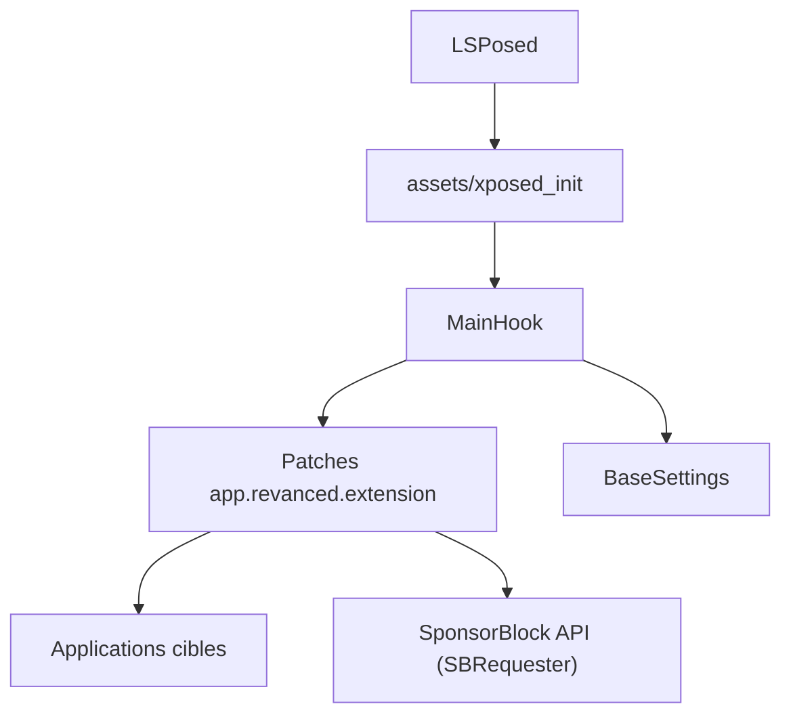

# chsbuffer/ReVancedXposed

> LSPosed module for Android that modifies YouTube, Reddit and other applications, for users with root access.

## The problem
Mobile applications show ads, restrict background playback or lock paid options.

## What it actually does
The module is loaded by LSPosed into the target applications' processes and hooks their methods. It removes YouTube ads, adds SponsorBlock, Return YouTube Dislike and DeArrow, and also acts on YouTube Music, Reddit, Instagram, Strava, AllTrails and Photomath (unlocking subscriptions or hiding ads). Settings live in an interface injected into the target applications.

## How it is wired

## Trying it
No command in the README: download the release or nightly version from the downloads page and install it in LSPosed.

## Cost and gotchas
Free, but root access is mandatory. The project went from ReVancedXposed to NexAlloy: you must export then re-import your settings by hand. It is not an official Morphe or ReVanced project.

## What it is not
Not a data or AI tool. Some patches unlock paid features of third-party applications, which may violate their terms of use.

## Alternatives
Morphe and ReVanced, cited in the credits as sources of the project.

## For you
Ignore: unrelated to a data, AI or MLOps profile, and it requires a rooted phone.
