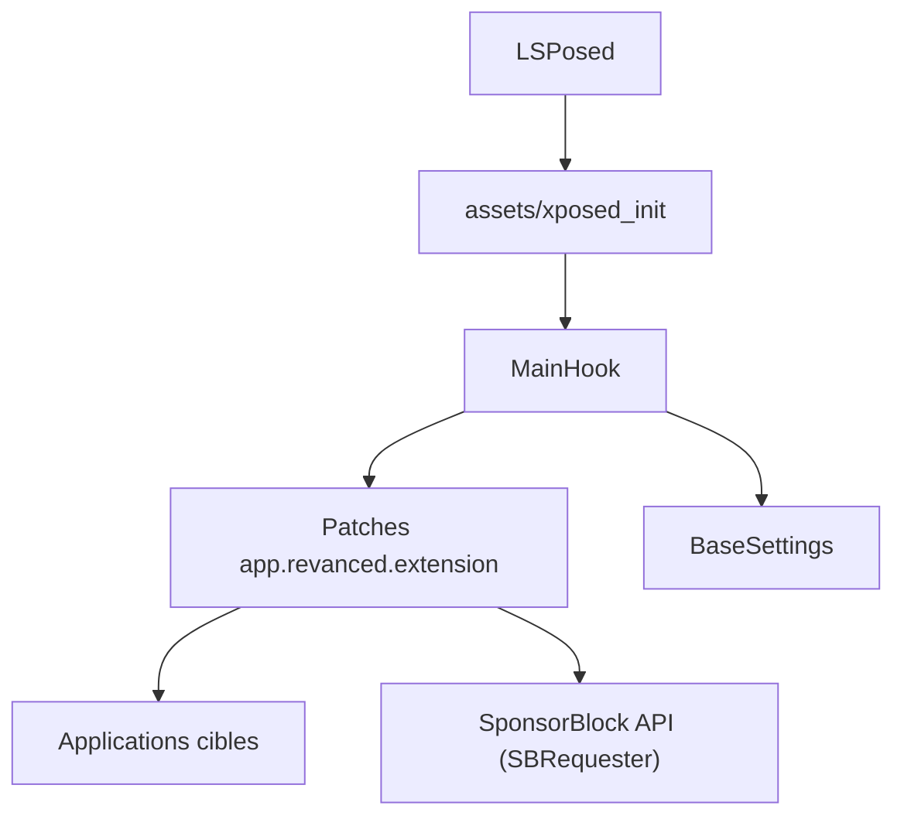

# chsbuffer/ReVancedXposed

> Module LSPosed pour Android qui modifie YouTube, Reddit et d'autres applications, pour utilisateurs avec accès root.

## Le problème
Des applications mobiles affichent des publicités, brident la lecture en arrière-plan ou verrouillent des options payantes.

## Ce que ça fait vraiment
Le module est chargé par LSPosed dans les processus des applications cibles et accroche leurs méthodes. Il retire les publicités de YouTube, ajoute SponsorBlock, Return YouTube Dislike et DeArrow, et agit aussi sur YouTube Music, Reddit, Instagram, Strava, AllTrails et Photomath (déblocage d'abonnements ou masquage de pubs). Les réglages sont dans une interface injectée dans les applications cibles.

## Comment c'est branché

## Essayer
Aucune commande dans le README : télécharger la version release ou nightly depuis la page des téléchargements et l'installer dans LSPosed.

## Coût et pièges
Gratuit, mais accès root obligatoire. Le projet est passé de ReVancedXposed à NexAlloy : il faut exporter puis réimporter ses réglages à la main. Ce n'est pas un projet officiel de Morphe ni de ReVanced.

## Ce que ce n'est pas
Pas un outil de data ou d'IA. Certains patchs débloquent des fonctions payantes d'applications tierces, ce qui peut enfreindre leurs conditions d'utilisation.

## Alternatives
Morphe et ReVanced, cités dans les crédits comme sources du projet.

## Pour toi
À ignorer : sans rapport avec un profil data, IA ou MLOps, et il exige un téléphone rooté.

