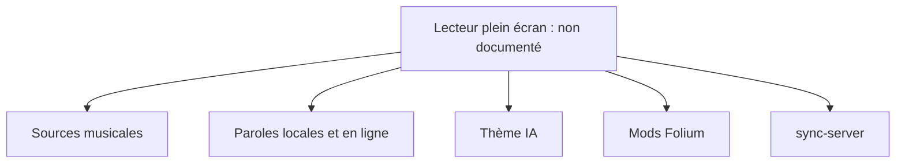

# chthollyphile/folia-major

> Music player centered on animated full-screen lyrics, with AI-generated themes.

## The problem
Music players display lyrics in a basic way, with no staging.

## What it actually does
The README (in Chinese) describes a web and Electron player: search and playback via NetEase, Kugou, QQ Music, Navidrome or a local library, automatic lyrics matching, AI generation of color themes, lyric animations, an experimental mod system and an optional sync server. No architecture diagram is provided.

## How it is wired


## Trying it
```bash
# Aucune commande documentée : installateurs sur la page Releases, déploiement Vercel ou Docker Compose décrits ailleurs.
```

## Cost and gotchas
Free. Depends on unofficial third-party music services; the README warns about copyright risks and restricts use to non-commercial learning.

## What it is not
Not a professional tool: a project "developed with the help of AI", with possible defects. AGPL-3.0 license.

## Alternatives
No alternative cited in the README.

## For you
Ignore: a consumer music player, unrelated to your work, and legally risky.
