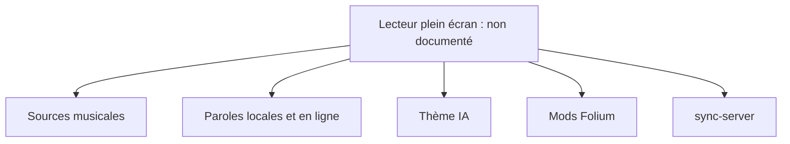

# chthollyphile/folia-major

> Lecteur de musique centré sur les paroles plein écran animées, avec thèmes générés par IA.

## Le problème
Les lecteurs de musique affichent les paroles de façon basique, sans mise en scène.

## Ce que ça fait vraiment
Le README (en chinois) décrit un lecteur web et Electron : recherche et lecture via NetEase, Kugou, QQ Musique, Navidrome ou bibliothèque locale, appariement automatique des paroles, génération de thèmes de couleurs par IA, animations de paroles, système de mods expérimental et serveur de synchronisation optionnel. Aucun schéma d'architecture n'est fourni.

## Comment c'est branché


## Essayer
```bash
# Aucune commande documentée : installateurs sur la page Releases, déploiement Vercel ou Docker Compose décrits ailleurs.
```

## Coût et pièges
Gratuit. Dépend de services musicaux tiers non officiels ; le README met en garde sur les risques de droits d'auteur et réserve l'usage à l'apprentissage non commercial.

## Ce que ce n'est pas
Pas un outil pro : projet « développé avec l'aide de l'IA », avec possibles défauts. Licence AGPL-3.0.

## Alternatives
Aucune alternative citée dans le README.

## Pour toi
À ignorer : lecteur de musique grand public, sans lien avec ton métier, et à risque juridique.

