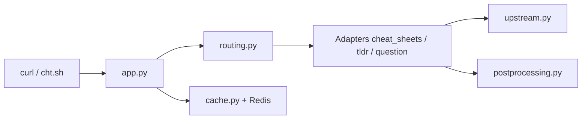

# chubin/cheat.sh

> Command and language cheat sheet, queryable with curl from a terminal, for developers.

## The problem
Looking up the syntax of `tar` or of a list function means leaving the terminal for a search engine.

## What it actually does
An HTTP service answers paths like `cheat.sh/tar` or `cht.sh/python/random+list+elements`. It aggregates community repositories (tldr, cheat, learnxinyminutes, cheat.sheets) and StackOverflow answers, formats them as code in the requested language and strips comments on request. The `cht.sh` client adds shell mode, history and completion. Editor plugins exist (Vim, Emacs, VS Code…). Docker Compose launches the service and Redis.

## How it is wired


## Trying it
```bash
curl cheat.sh/tar
curl cht.sh/python/random+list+elements
curl https://cht.sh/:cht.sh > "$PATH_DIR/cht.sh"
docker-compose up
```

## Cost and gotchas
Free, no account. The public service depends on the project's server; requests are sent to it. Docker mode is an "early implementation" reserved for internal, dev or personal use. Last push: December 23, 2025.

## What it is not
Not a cheat sheet repository of its own: it relays external sources, and a generated answer may not be 100% accurate.

## Alternatives
- tldr-pages/tldr: upstream source, available offline.
- cheat/cheat: another upstream source of command sheets.

## For you
Adopt for command-line troubleshooting without leaving the terminal, knowing that your queries go through a service run by a single person.
