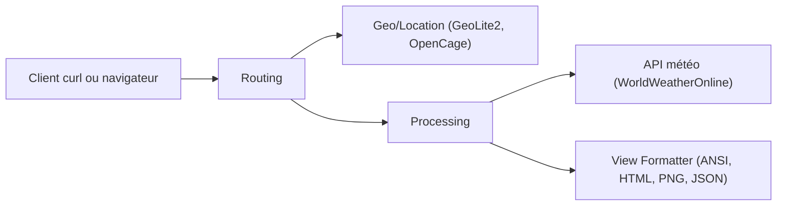

# chubin/wttr.in

> Weather service queryable with curl: ANSI text, HTML, PNG, JSON or Prometheus.

## The problem
Checking the weather from a terminal, a status bar or a script requires going through an API with a key or a website.

## What it actually does
`curl wttr.in/City` returns a text report; parameters choose the format (one line, JSON j1, Prometheus p1, rich view v2, map v3), units, language and moon phase. Location by name, airport, IP address or domain. It integrates with tmux, WeeChat and conky. The README also describes self-hosting: a single Go binary with GeoLite2 and OpenCage.

## How it is wired


## Trying it
```bash
curl wttr.in
curl wttr.in/London
curl 'wttr.in/Nuremberg?format=3'
curl wttr.in/Detroit?format=j1
curl wttr.in/Moon
```

## Cost and gotchas
Free public use; for self-hosting you need a MaxMind account and an OpenCage token. The README recommends a reasonable update interval in tmux and offers wttr.is as a fallback domain. The README provided is truncated in the middle of the Prometheus section.

## What it is not
Not a primary weather data API: the data comes from an upstream provider. The v2 mode is experimental, terminal-only and English-only.

## Alternatives
- wego: the project's original wrapper, cited in the README.

## For you
Adopt for occasional use: no installation, j1 format usable in a script, but you depend on a public service.
