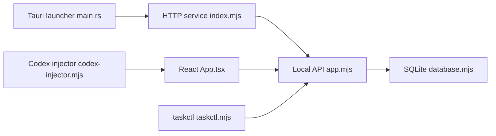

# chuspeeism/dashi-taskboard

> Local task board that embeds in the Codex application, with a dedicated CLI and Skill, for Codex users.

## The problem
Tracking what a Codex agent does across several tasks requires a separate dashboard that you synchronize by hand.

## What it actually does
A Node service with a SQLite database and HTTP API, a React interface (Kanban, Gantt, list), a `taskctl` CLI and a `manage-taskboard` Skill that teaches the agent the todo → in_progress → in_review cycle. A CDP injector inserts the entry into Codex's sidebar without modifying the application. A Tauri launcher packages everything (macOS, Windows, Linux). A shared mode through a Cloudflare Worker, D1 and R2 exists.

## How it is wired


## Trying it
```bash
npm install
npm run build
npm start
npm run taskctl -- project create --id my-project --name "My project" --workspace-path /absolute/path/to/repository
CODEX_TASKBOARD_HOST=127.0.0.1 npm run codex
```

## Cost and gotchas
Free. Node 22.5+; Rust 1.88+ for application builds. By default the service listens on `0.0.0.0` with no authentication: set `CODEX_TASKBOARD_HOST=127.0.0.1`. CDP is not authenticated: run the launcher only with trusted code.

## What it is not
Not a standalone tool: it depends on the official Codex application and its internal markers, which may change. Windows builds are not signed.

## Alternatives
No alternative named in the README.

## For you
Worth watching: useful if you work in Codex, but coupled to an unstable third-party application; otherwise another task manager is enough.
